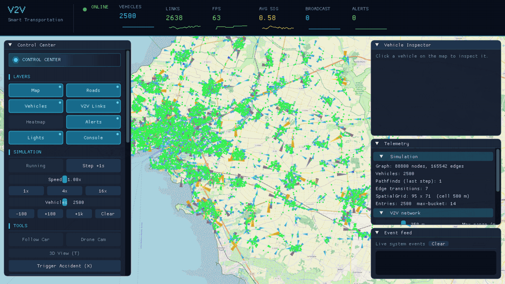
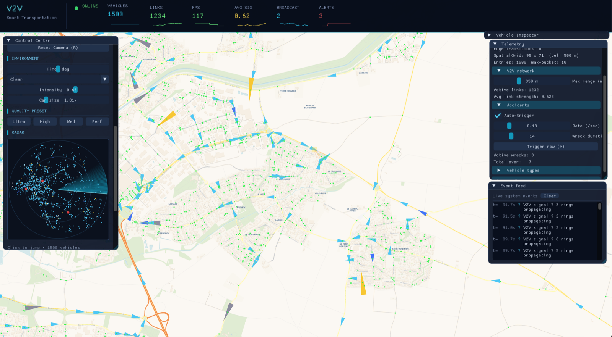
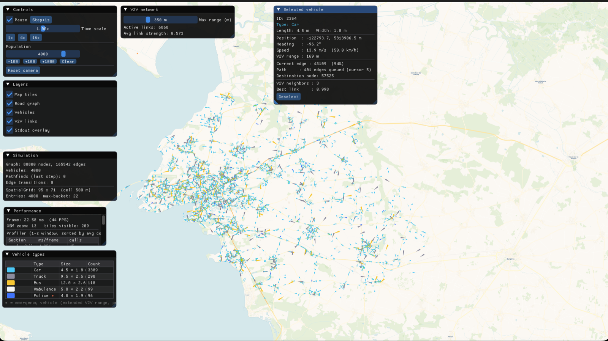

# 🚗 V2V Simulator

**Real-time Vehicle-to-Vehicle communication simulator in C++20 / OpenGL** — thousands of vehicles drive on a real OpenStreetMap road network, route themselves with A\*, and continuously form a live radio network you can watch, inspect and stress-test.


<p align="center">
  
</p>

> Initial target: **2,000 vehicles at 60 FPS**. Final result: **19,000 vehicles at 120 FPS** on a MacBook M2 (~3.6 ms per frame).

## ✨ What it does

| | |
|---|---|
| 🗺️ **Real maps** | Parses any OpenStreetMap `.osm` extract into a directed road graph (one-ways, roundabouts, `maxspeed` tags), drawn over async-loaded map tiles. |
| 🧭 **Routing** | Every vehicle runs **A\*** minimising *travel time* (not distance), with a per-frame search budget so frame times stay flat. |
| 📡 **V2V network** | Radio model `s(d, R) = 1 − (d/R)²`, links rebuilt every frame through a uniform **spatial grid** (500 m cells), **multi-hop broadcasts** that ripple through the fleet. |
| 🚑 **Realistic behaviour** | Five vehicle types (car, truck, bus, ambulance, police), per-edge anti-collision, auto-detected traffic lights, civilians yielding to emergency vehicles. |
| 💥 **ITS scenarios** | Accidents (manual or random) that trigger automatic V2V alerts, density heat-map, weather (rain / fog reduces radio range), day/night cycle. |
| 🔍 **Vehicle inspector** | Click any vehicle to follow it: route, neighbours, link quality, messages sent/received and a small "decision engine" explaining what it does next. |
| 📊 **Dashboard** | Dear ImGui control centre with live stats, radar mini-map, event feed and a scoped profiler. |

<p align="center">
  
  
</p>

## ⚙️ How it is built

```
src/
  graphics/    Window, Renderer, Camera2D, Shader       — OpenGL 3.3 core, instanced rendering
  map/         MapProjection, TileCache, TileLoader      — Web Mercator, async libcurl workers, LRU cache
  graph/       RoadGraph, OSMParser                      — pugixml, directed adjacency list
  simulation/  Vehicle, SimulationEngine, PathFinder     — fixed-step engine, A*
  v2v/         V2VNetwork, Broadcast, Accidents          — radio model, multi-hop, alerts
  ui/          ImGui panels                              — dashboard, inspector, radar
  utils/       SpatialGrid, Profiler, Logging
shaders/       GLSL programs
```

Key performance choices:

- **Instanced rendering** — one static 3-vertex VBO + one per-instance buffer for all vehicles.
- **Uniform spatial grid** — neighbour queries are O(k) instead of O(n²).
- **Background tile loading** — 4 libcurl workers decode PNGs off the GL thread, the GL thread only uploads textures.
- **Budgeted A\*** — at most 32 path searches per step; vehicles random-walk at intersections until their path arrives.

## 🚀 Build & run

Requirements: a C++20 compiler, CMake ≥ 3.20, Python 3 with **jinja2** (used by the GLAD generator at configure time) and libcurl (shipped with macOS; `libcurl4-openssl-dev` on Debian/Ubuntu).

```bash
pip install jinja2
cd V2V
cmake -B build -S . -DCMAKE_BUILD_TYPE=Release
cmake --build build -j
./build/bin/V2V data/la-rochelle.osm 2000     # OSM file + number of vehicles
```

All other dependencies (GLFW, GLAD, GLM, Dear ImGui, pugixml, stb_image) are fetched automatically by CMake. Map extracts are not committed (too large) — see [`V2V/README.md`](V2V/README.md) for a one-line Overpass command to download any city.

**Controls:** right-drag to pan · wheel to zoom · click a vehicle to inspect it · `SPACE` pause · `+`/`-` time scale · `X` trigger an accident · `T` 3D view · `G M V L` toggle roads / map / vehicles / links.

## 📄 Documentation

- [`V2V/README.md`](V2V/README.md) — technical notes (layout, controls, data)
- [`V2V/rapport/Rapport_V2V_detaille.pdf`](V2V/rapport/Rapport_V2V_detaille.pdf) — full project report (French)

## 👩‍💻 Authors

Built by **Meryem Belmouaddine** and Mohammed Chouadra — Master's in Computer Science & Mobility, Université de Haute-Alsace (supervisor: Laurent Moalic).

Map data © [OpenStreetMap](https://www.openstreetmap.org/copyright) contributors.
